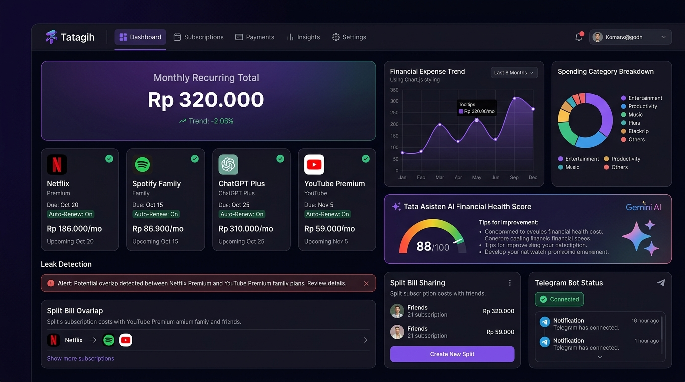

# Lintas - Cross-Device Local Productivity Ecosystem

Lintas is a cross-device productivity platform that seamlessly bridges Android smartphones with Windows personal computers over local Wi-Fi networks (LAN) with zero external internet dependencies or third-party cloud relays.

Designed for security, speed, and privacy, all data exchanges, input signals, and file transfers execute peer-to-peer directly between devices on the same local subnet.

---

## Application Interface Preview

### Windows Companion Host Dashboard (Port 8945, QR Pairing & Drop Zone)


---

## Architectural Mechanics

Lintas implements an asynchronous local Client-Server peer-to-peer architecture:

1. Windows Host Companion Server:
   When launched on Windows, the application initiates an embedded HTTP and WebSocket server bound to local port 8945. It renders an ephemeral QR code encoding local connection parameters (LAN IP, port, session nonce, and time-expiring cryptographic tokens).

2. Android Mobile Controller:
   On Android, the client connects instantaneously by scanning the QR code with the device camera or utilizing automated UDP broadcast auto-discovery to detect active Windows hosts across the local Wi-Fi subnet.

3. Bi-Directional Low-Latency Exchange:
   Once the WebSocket channel is established, devices exchange real-time pointer coordinates, modifier key inputs, clipboard mutations, and multi-gigabyte binary files at full local router speeds.

---

## Core Capabilities

### 1. Rapid Pairing and Auto-Discovery
- Ephemeral QR Code Handshake: Connect within seconds by scanning a time-expiring QR code directly from the PC display.
- LAN Subnet Auto-Discovery: Automated broadcast scanning detects active Lintas companion hosts without requiring manual IP entry.

### 2. Multi-Touch Remote Touchpad
- High-Frequency Cursor Tracking: Fluid desktop cursor positioning via the mobile touch surface.
- Native Gesture Mapping: Supports single-finger primary clicks, two-finger secondary clicks, smooth two-finger vertical scrolling, and hold-to-drag interactions.

### 3. Virtual Hardware Keyboard
- Text Injection: Stream continuous text or lengthy paragraphs directly into the active Windows desktop focus.
- Modifier & Control Keys: Full support for functional modifier keys (Ctrl, Alt, Shift, Tab, Enter, Backspace, Esc, and arrow navigation).

### 4. Instant Drop (High-Speed Local File Transfer)
- Bi-Directional File Transmission: Dispatch large files from mobile to PC or from PC to mobile across the local network.
- Uncapped LAN Bandwidth: Transfers operate at the maximum physical speed of your local Wi-Fi router, consuming zero external data quotas.
- SHA-256 Integrity Verification: Computes cryptographic SHA-256 checksums before and after transit to guarantee zero data corruption.

### 5. Universal Bi-Directional Clipboard
- Real-Time Clipboard Synchronization: Strings and links copied on one device appear immediately on the companion device clipboard.
- Automatic URL Recognition: Intelligently detects web links, offering one-click triggers to open URLs in the destination system browser.

### 6. NearLock (Proximity-Based Workstation Lock)
- Presence Monitoring: Continuously evaluates connection ping latency and signal presence.
- Automated Security Lockout: Issues automated workstation lock commands (`Win + L`) when the smartphone leaves local proximity beyond established grace periods.

### 7. Presentation Remote Mode
- Slide Controller: Navigate slide decks forward and backward across presentation software (PowerPoint, Keynote, PDF Viewers).
- Utility Tools: Integrated display blackout toggle and speech timer to monitor presentation duration.

---

## Technology Stack

- Framework: Flutter (targeting Android Mobile and Windows Desktop)
- Languages: Dart 3.x, C++ (Windows Native Runner & Win32 API bridge)
- State Architecture: Flutter Riverpod
- Navigation: GoRouter with platform-adaptive routing
- Networking: Dart `HttpServer`, `HttpClient`, and low-latency WebSockets
- Cryptography: SHA-256 streaming hashing via `crypto` package
- QR Engine: `mobile_scanner` (Android) and `qr_flutter` (Windows)

---

## System Requirements

### Host Computer (Windows)
- Operating System: Windows 10 (Version 1809+) or Windows 11 (64-bit)
- Network: Local Wi-Fi or Ethernet LAN connection
- Firewall: Port 8945 permitted for inbound local traffic

### Mobile Device (Android)
- Operating System: Android 7.0 (Nougat, API Level 24) or higher
- Features: Active Wi-Fi and Camera (for QR code scanning)

---

## Running the Application

### 1. Prepare Environment
Ensure the host development system has:
- Flutter SDK (3.11.5 or higher)
- Visual Studio with "Desktop development with C++" workload installed
- Android SDK installed

Validate environment readiness:
```bash
flutter doctor
```

### 2. Install Dependencies
```bash
flutter pub get
```

### 3. Launch on Windows (Host Companion Mode)
```bash
flutter run -d windows
```
The application will launch the companion window, start the local server on port 8945, and display the pairing QR code.

### 4. Launch on Android (Controller Mode)
Connect your Android device via USB (with USB Debugging active) and run:
```bash
flutter run -d <device-id>
```

### 5. Establish Connection
1. Ensure both devices share the same local Wi-Fi subnet.
2. Tap "Connect PC Now" or open the QR scanner within the Android app.
3. Aim the camera at the QR code displayed on the Windows monitor.
4. Once connected, control features activate instantly.

---

## Author

Anak Agung Ngurah Krisna Artha Wibawa ([ANTARTICA1](https://github.com/ANTARTICA1))

## License

This project is licensed under the MIT License.